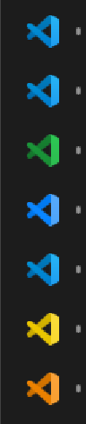

# TaskbarIconOverlay

A Windows utility that applies custom overlay icons to taskbar buttons based on window titles or process names.  Optimized for VS Code/VSCodium.

**New:** each VS Code window's taskbar icon can take on its [Peacock](https://github.com/johnpapa/vscode-peacock) colour automatically. The VS Code logo itself is recoloured, and it works with Remote SSH. See [Peacock Colours for VS Code](#peacock-colours-for-vs-code).


## Motivation

I use Windows 11 combined with [Windhawk's "Disable grouping on the taskbar"](https://windhawk.net/mods/taskbar-grouping) mod which means my taskbar items aren't grouped and it shows the icon only. As a result, when running an application in multiple instances (like VS Code), it's difficult to distinguish which icon corresponds to which project or window.

While Windows doesn't allow you to easily change the icon of a program for different instances, it does support overlay icons (small badges on taskbar buttons) - and this is what this tool takes full advantage of. By adding custom overlay icons to taskbar buttons, you can easily identify specific windows at a glance.

While this tool was primarily built to distinguish between multiple VS Code/VSCodium workspace windows (and perhaps other popular text editors in the future), it's kept generic enough to work with any application. Perfect for developers working with multiple Visual Studio Code workspaces, browser windows for different projects, or any scenario where you want visual distinction between similar applications.

## Requirements

- **Platform**: Windows x86-64 (Intel/AMD 64-bit processors)
- **Tested on**: Windows 11 25H2
- Other Windows versions may work but have not been tested
- .NET 8 Desktop Runtime installed

## How to Use

### Quick Start

1. Download the latest release in the releases section of GitHub
2. Add your icons to an `icons` folder in the same directory
3. Run the executable (make sure .NET 8 Desktop Runtime installed)

**Optional:** Create a `config.json` file if you want to customize the icons folder location (see Configuration section below)

### Configuration (config.json)

**Optional:** By default, the tool loads icons from the `icons` folder in the same directory as the executable.

If you want to use a different location, create a `config.json` file in the same directory as the executable:

```json
{
  "IconsPath": "C:\\Path\\To\\Your\\Icons"
}
```

- `IconsPath`: Directory containing your `.ico` files (relative to the executable, defaults to `icons`)
- `PeacockEnabled`: Colour VS Code taskbar icons from Peacock (default `true`; also toggled from the tray menu)
- `PeacockStyle`: `Icon` (recolour the VS Code logo, default), `Overlay` (small coloured badge) or `IconAndOverlay`

Setting names are case-insensitive.

### Icon Naming

Icons should be named to match:
- **Process name**: `chrome.ico`, `firefox.ico`, `code.ico`
- **VS Code workspaces**: The tool automatically extracts workspace names from VS Code window titles

For example, if you have a VS Code workspace named "TaskbarIconOverlay", create `TaskbarIconOverlay.ico` in your icons folder.

## Where to Get Icons

- [icon-icons.com](https://icon-icons.com/) - Large collection of free icons
  - Download the `.ico` file format (not PNG or other formats)
  - 512px resolution works well
- Convert PNG images to ICO format using [CloudConvert](https://cloudconvert.com/png-to-ico)

## Special Logic for VS Code

The tool includes special handling for Visual Studio Code and VSCodium:

- Automatically extracts workspace/folder names from VS Code window titles
- Looks for matching `.ico` files in a subfolder named after the process (e.g., `icons/Code/` for VS Code, `icons/VSCodium/` for VSCodium)
- Falls back to the process name (`code.ico` or `vscodium.ico`) in the root icons folder if no workspace-specific icon exists

**Example:** If you have a VS Code workspace named `my-cool-project`, the tool will look for `icons/Code/my-cool-project.ico`. For VSCodium, it would look for `icons/VSCodium/my-cool-project.ico`.

This allows different VS Code windows to have different overlay icons based on which project you're working on.

## Peacock Colours for VS Code

If you run several VS Code windows with ungrouped taskbar buttons and colour them with
[Peacock](https://github.com/johnpapa/vscode-peacock), TaskbarIconOverlay can recolour each
window's taskbar icon to its Peacock colour. A red Peacock window gets a red VS Code logo, a
green one a green logo, and changing the colour updates the icon within a second.



### Install

1. **Install the companion extension** (one `.vsix`, installed in your local VS Code):
   ```powershell
   cd vscode-extension
   npm install
   npm run package          # creates taskbar-icon-overlay-peacock-1.0.0.vsix
   code --install-extension taskbar-icon-overlay-peacock-1.0.0.vsix
   ```
   Or in VS Code: *Extensions* → `...` → *Install from VSIX...*. It is a UI extension,
   so it runs on Windows even in Remote SSH windows. You don't install anything on your
   SSH hosts.
2. **Run TaskbarIconOverlay** (see Quick Start). Peacock integration is on by default.
3. Open or reload your VS Code windows. Their taskbar icons take their Peacock colours.

No per-workspace configuration, icon files or colour lists are needed.

### How it works

```
VS Code window (local UI extension host)          TaskbarIconOverlay (Windows)
────────────────────────────────────────          ─────────────────────────────────────────
reads the effective Peacock colour through        watches %LOCALAPPDATA%\TaskbarIconOverlay\sessions
the VS Code configuration API (Remote SSH too) ─► matches each report to a taskbar window
writes <session>.session.json atomically          recolours the VS Code logo (WM_SETICON)
(one file per window, deleted on close)           or adds an overlay badge (ITaskbarList3)
```

**Colour resolution** mirrors Peacock's source code:
* Remote windows use `peacock.remoteColor`, falling back to `peacock.color`. Local windows use `peacock.color`.
* If Peacock has applied colours to the workspace's `workbench.colorCustomizations`
  (activity bar → status bar → title bar, with Peacock's lighten/darken adjustments undone),
  that applied colour wins, because it is what the window actually shows.
* Hex, named colours (`red`, `rebeccapurple`), `rgb()`, `hsl()` and `hsv()` are supported.
* If there is no effective colour, the window's icon is left unchanged.

**Window matching** never guesses:
* VS Code's extension API does not expose a native window handle. The extension reports
  `vscode.workspace.name`, which VS Code computes with the same function as the
  `${rootName}` part of the window title, including the ` [SSH: host]` suffix. So
  `api [SSH: alpha]` and `api [SSH: beta]` are told apart by their titles.
* A window is coloured only if its workspace name appears as a whole title segment in
  exactly one VS Code window, and no other reporting window claims that title. Dirty
  markers and changing editor names don't matter.
* When titles are identical (same folder name on the same host, or a custom
  `window.title` without `${rootName}`), switch to the window once (Alt+Tab or click).
  The extension reports the moment it gains focus, and TaskbarIconOverlay attributes
  that to the Windows foreground window. Rapid switching is rejected as ambiguous.
* Only windows owned by the same VS Code main process as the reporting extension host
  are considered (VS Code, Insiders and VSCodium never mix). All windows of one VS Code
  share a process, so the process ID alone is never used to pick a window.

**Lifecycle:** the extension deletes its file when the window closes or reloads. Files
left by crashed or killed windows are detected (process gone or PID reused) and removed.
When a window's report disappears its icon is restored after a few seconds, so a reload
doesn't flicker. On exit, or when the integration is switched off, every icon is
restored. Explorer restarts (`TaskbarCreated`) re-apply everything.

### Tray menu

* **Peacock Colours (VS Code)**: switch the integration on or off (restores icons when off).
* **Peacock Status...**: per-window diagnostics: reported colour and its source, how the
  window was matched, and why a window is not coloured (ambiguous, no colour, extension not
  reporting). The same text is written to `%LOCALAPPDATA%\TaskbarIconOverlay\peacock-status.txt`.
* The tray tooltip shows a one-line summary such as `Peacock: 7 coloured, 1 unmatched`.

In VS Code, **Taskbar Icon Overlay: Show Peacock Taskbar Status** shows what that window
reports. Set `"taskbarIconOverlay.enabled": false` to exclude a window or workspace.

### Privacy

Each session file contains: the workspace name shown in the title bar, the SSH host label,
a hash of the workspace URI (not the path), the colour, process IDs and timestamps. It
contains no source code, file paths or credentials, and nothing leaves your machine.

### Limitations

* **Full-icon recolouring** uses `WM_SETICON` on VS Code's window. On Windows 11 25H2 with
  Windhawk's ungrouped taskbar this was verified to replace the taskbar button icon. Other
  taskbar configurations (e.g. Windows' own *combine buttons*) may show the group's icon
  instead. In that case use `"PeacockStyle": "Overlay"` or `"IconAndOverlay"`.
* The recoloured icon handles belong to TaskbarIconOverlay. If it is **killed** (not exited
  normally), coloured windows may show a blank icon until it is started again or the window
  is reopened. Exiting from the tray restores all icons.
* Windows with identical titles stay uncoloured until you switch to each one once. The
  status window says which ones.
* Windows that VS Code opened before TaskbarIconOverlay started are matched by title right
  away. Focus-based identification needs one focus switch after TaskbarIconOverlay starts.
* The extension has to be installed in each VS Code profile you use.

A step-by-step manual test, including three simultaneous Remote SSH workspaces, is in
[docs/peacock-manual-test.md](docs/peacock-manual-test.md).

## How to Develop & Test

To test the program during development without building an executable:

**Prerequisites:**
- .NET SDK (tested with version 10.0.1, released December 9, 2025)
- Download from: [https://dotnet.microsoft.com/en-us/download/dotnet?cid=getdotnetcorecli](https://dotnet.microsoft.com/en-us/download/dotnet?cid=getdotnetcorecli)

**Run the program:**
```powershell
dotnet run
```

**Run the tests:**
```powershell
dotnet test tests/TaskbarIconOverlay.Tests      # C#: matching, focus correlation, colours, icons, cache
cd vscode-extension; npm install; npm test        # TypeScript: Peacock precedence, colour parsing, identity, state files
```

The companion extension needs Node.js 18+ to build. `npm run package` creates the `.vsix`.

### How to Compile

To build the executable for distribution:

```powershell
dotnet publish -c Release -r win-x64 -o .\TaskbarIconOverlay
```

## TODO

- [ ] Support for other VSCode derivatives (Cursor, Kiro, etc.)
- [ ] Support for Zed Editor
